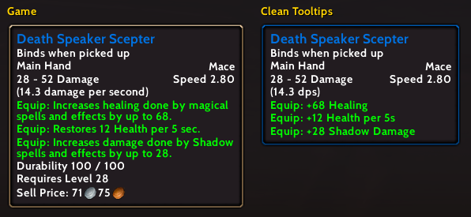

# Clean Tooltips

**Shorter, cleaner tooltips.**

## Clean-up

- Hide the sell price
- Hide durability on undamaged items
- Hide met requirements
- Hide Soulbound, and Unique
- Hide the faction and PvP on units
- Shorten **Use:** and **Equip:** lines
- And more!

## Look

- Class colours for player names
- Border colours: class, reaction, or item quality
- Health bar texture, font and background colour

## Sources

- See which addon added each tooltip line
- Hide another addons lines either individually or entirely

It's always better to turn a line off in the addon that adds it. This is for the ones you can't.

## How to use

- `/ctt` settings
- `/ctt sources` show or hide line sources
- `/ctt last` lists the last tooltip's lines
- `/ctt help`

## Feedback

Found a bug or a line that should be shortened? Report it on GitHub: https://github.com/LaryIsland/CleanTooltips/issues